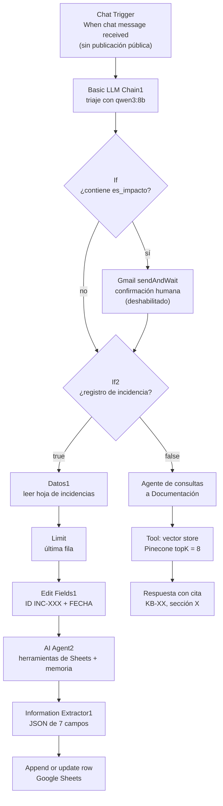
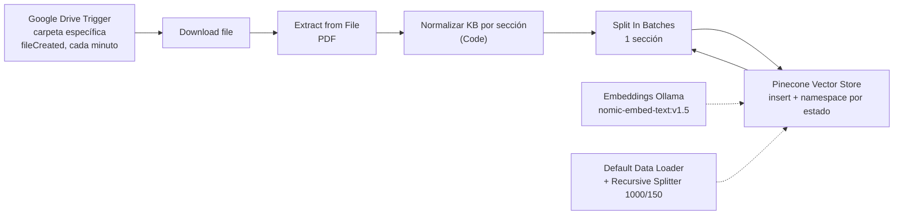

# Memoria técnica — Asistente de Negocio

**Automatización de consultas documentales y registro de incidencias con n8n, RAG local y Google Drive/Sheets**

| Ficha del proyecto | |
|---|---|
| Fecha | 2026-11-01 |
| Orquestador | n8n 2.41.7, self-hosted sobre Docker |
| Workflows activos | `Asistente de Negocio` y `Actualizar Drive Asistente` |
| Modelo de lenguaje | `qwen3:8b` servido por Ollama |
| Embeddings | `nomic-embed-text:v1.5` servido por Ollama |
| Base vectorial | Pinecone, índice `n8n-contratos` |
| Integraciones | Google Drive y Google Sheets mediante OAuth2; Gmail (nodo deshabilitado) |

---

## 1. Resumen

El proyecto implementa un asistente conversacional para empleados que resuelve dos tipos de peticiones con una única entrada de chat:

1. **Consultas sobre normativa interna**, respondidas con evidencia documental y citas.
2. **Registro y modificación de incidencias**, persistidas en una hoja de cálculo de Google Sheets.

La base de conocimiento se mantiene de forma automática: cuando se sube un PDF a una carpeta concreta de Google Drive, un segundo workflow lo descarga, extrae el texto, lo normaliza por secciones, genera embeddings y lo indexa en Pinecone. El asistente consulta exclusivamente la documentación marcada como vigente.

El diseño prioriza cuatro ideas:

- **Coste cero en servicios de IA:** inferencia y embeddings se ejecutan en local con Ollama; no se depende de APIs de pago.
- **Trazabilidad:** cada respuesta documental debe citar documento y sección; cada incidencia tiene un identificador determinista y una fecha generada por el sistema.
- **Separación de responsabilidades:** la ingesta documental y la atención al usuario son workflows independientes.
- **Determinismo donde importa:** los identificadores, fechas y escrituras en la hoja no se delegan al modelo; el LLM se reserva para clasificar, redactar y extraer información.

---

## 2. Arquitectura

El sistema se compone de dos workflows activos que comparten el mismo índice vectorial y el mismo stack local de modelos.

### 2.1 Workflow `Asistente de Negocio`



**Flujo de atención.**

1. **Entrada única.** El disparador es un Chat Trigger de n8n, configurado sin publicación pública: el chat se usa desde el editor y no queda expuesto como webhook abierto.
2. **Triaje.** `Basic LLM Chain1` recibe el mensaje y pide al modelo una decisión simple: `true` si es un registro de incidencia, `false` si es una consulta. Si detecta una operación con impacto —por ejemplo, una comunicación externa, un cambio de estado de expediente o una consulta de estado— añade la marca `es_impacto`.
3. **Detección de impacto.** El nodo `If` comprueba si la salida contiene `es_impacto`. La rama afirmativa pasa por un nodo Gmail `sendAndWait` pensado para solicitar confirmación humana. **Ese nodo está actualmente deshabilitado**, por lo que hoy el flujo continúa sin puerta de aprobación real.
4. **Separación registro/consulta.** `If2` comprueba si la salida del clasificador contiene `true`:
   - **Rama de incidencia:** lee la hoja de registro, recorta la entrada a una sola fila (`Limit`), calcula el siguiente ID (`INC-001`, `INC-002`, …) y la fecha actual en el nodo `Edit Fields1`, y entrega el contexto a `AI Agent2`. El agente dispone de dos herramientas de Google Sheets: búsqueda por ID y `appendOrUpdate`. Después, `Information Extractor1` fuerza un JSON con siete campos y el nodo final `Append or update row in sheet1` vuelve a escribir en la hoja usando el ID como clave de coincidencia.
   - **Rama documental:** invoca al `Agente de consultas a Documentación`, un agente RAG con memoria de conversación y una herramienta de búsqueda vectorial sobre Pinecone. El *system prompt* obliga a buscar siempre antes de responder, citar documento y sección, no inventar y devolver una frase exacta cuando no hay evidencia: «No se ha encontrado nada de información al respecto».

**Decisiones de diseño del asistente.**

| Decisión | Motivo | Contrapartida |
|---|---|---|
| Un único chat con triaje por LLM | Evita varios asistentes y mantiene una experiencia de usuario simple | Depende de la fiabilidad del clasificador |
| ID y fecha deterministas en `Edit Fields1` | Auditoría y correlación fiables; no se deja la numeración al modelo | Asume que la hoja está ordenada y que el último ID es el mayor |
| Agente + `Information Extractor` | Separa razonamiento y validación de esquema antes de escribir | Añade una llamada adicional al modelo |
| Google Sheets como registro operativo | Herramienta gratuita, visible y editable por el equipo | Poco adecuada para alta concurrencia o grandes volúmenes |
| Memoria de ventana de 10 mensajes | Continuidad conversacional sin contexto ilimitado | Puede perder referencias de conversaciones largas |
| `.first()` en la rama documental | Evita fallos de expresiones en subnodos y después de un `If` | Requiere recordar qué contexto usar en cada nodo |

### 2.2 Workflow `Actualizar Drive Asistente`



**Pipeline de ingesta.**

1. **Disparador.** `Google Drive Trigger` vigila una carpeta concreta y se activa con `fileCreated`. La comprobación es por sondeo cada minuto; no requiere exponer un webhook público.
2. **Descarga y extracción.** `Download file` obtiene el archivo y `Extract from File` extrae el texto del PDF.
3. **Normalización por secciones.** El nodo `Normalizar KB por sección` valida que el documento cumpla un contrato explícito:
   - cabecera con `ID documental` (formato `KB-XX`), `Versión` y `Estado`;
   - título en la primera línea no vacía;
   - secciones numeradas con el patrón `1.`, `1.1.`, `2.`…
   - nombre de archivo tomado del nodo de descarga.
   Si falta la cabecera, no hay secciones o alguna sección está vacía, el nodo lanza un error descriptivo y aborta la ingesta en lugar de indexar contenido incompleto.
4. **Un ítem por sección.** El código devuelve una lista de secciones; `Split In Batches` las procesa de una en una para controlar el tamaño de cada operación.
5. **Indexación.** `Pinecone Vector Store` inserta cada sección en el índice `n8n-contratos`. El namespace se decide con una expresión: `estado === 'VIGENTE'` va a `kb-vigente-2026-10`; cualquier otro estado va a `kb-obsoletos`.
6. **Enriquecimiento.** `Default Data Loader` adjunta metadatos por fragmento y `Recursive Character Text Splitter` divide el texto con tamaño 1000 y solape 150 caracteres. Los embeddings se generan con `nomic-embed-text:v1.5` en Ollama.

**Contrato documental esperado.**

```text
Política de vacaciones y permisos
ID documental: KB-02 | Versión: 2026-10 | Estado: VIGENTE

1. Marco general
...
2. Duración de las vacaciones
...
```

Este contrato es la decisión más importante de la ingesta: convierte un PDF arbitrario en una estructura verificable y permite que cada fragmento herede `document_id`, `titulo`, `version`, `seccion` y `estado`. La detección es heurística —una lista numerada del cuerpo podría interpretarse como sección—, por lo que el formato debe mantenerse consistente.

---

## 3. Herramientas gratuitas utilizadas

| Herramienta | Función en el sistema | Coste / licencia |
|---|---|---|
| **n8n 2.41.7** self-hosted | Orquestación de ambos workflows, chat, credenciales y ejecuciones | Fair-code (Sustainable Use License); autoalojado sin coste para uso interno |
| **Docker** | Contenedor del orquestador | Docker Engine/Desktop sin coste para uso personal o educativo |
| **Ollama** | Servidor local de modelos | MIT |
| **qwen3:8b** | Clasificación, agente de incidencias, extracción y respuestas RAG | Pesos abiertos, licencia Apache 2.0 |
| **nomic-embed-text:v1.5** | Embeddings de documentos y consultas | Licencia Apache 2.0 |
| **Pinecone** | Base de datos vectorial gestionada | Plan gratuito de Pinecone |
| **Google Drive** | Repositorio de PDFs de entrada | Cuota gratuita de la cuenta de Google |
| **Google Sheets** | Registro operativo de incidencias | Cuota gratuita de la cuenta de Google |
| **Gmail** | Confirmación humana de operaciones con impacto | Cuota gratuita; nodo actualmente deshabilitado |
| **n8n Chat Trigger** | Interfaz de chat integrada | Incluido en n8n |

**Por qué esta combinación.** Todo el procesamiento de lenguaje se hace en local: los documentos no se envían a un proveedor de LLM. Pinecone actúa únicamente como almacén vectorial y Google Drive/Sheets cubren el almacenamiento y la edición que el equipo ya utiliza. El resultado es un sistema sin suscripciones de IA, reproducible en un equipo de desarrollo y fácil de explicar.

**Límites asumidos.** El modelo local de 8B ofrece una calidad inferior a los modelos frontera y consume CPU/GPU y RAM del host. El plan gratuito de Pinecone impone límites de almacenamiento y operaciones. Las cuotas de Google pueden agotarse con sondeos frecuentes o muchas escrituras.

---

## 4. Estrategia RAG

### 4.1 Ingesta: de PDF a vectores

La ingesta no trocea el PDF directamente. Primero lo convierte en una representación estructurada:

```text
PDF → texto → validación de cabecera → detección de secciones numeradas
    → un ítem por sección → splitter recursivo → embeddings → Pinecone
```

Ventajas de normalizar antes de trocear:

- **Precisión:** cada fragmento pertenece a una sección concreta y conserva su número.
- **Citabilidad:** la respuesta puede referirse a `KB-02, sección 2` sin inferir la sección a partir del texto.
- **Aislamiento:** un PDF mal formado falla al principio, no contamina el índice con fragmentos sin metadatos.
- **Mantenimiento:** la unidad de conocimiento es la sección, no el documento completo.

### 4.2 Metadatos por fragmento

| Campo | Ejemplo | Uso |
|---|---|---|
| `document_id` | `KB-02` | Identificación y cita |
| `titulo` | `Política de vacaciones` | Contexto para el modelo |
| `version` | `2026-10` | Trazabilidad de la versión |
| `seccion` | `2` | Cita precisa |
| `estado` | `VIGENTE` / `OBSOLETA` | Enrutamiento de namespace |
| `nombre_archivo` | `KB-02_vacaciones.pdf` | Auditoría del origen |

Además, el texto de cada sección se prefija con `document_id | titulo | Sección X | Estado: ...` antes de pasarlo al splitter. Así el fragmento conserva contexto incluso si el splitter lo separa del encabezado original.

### 4.3 Recuperación y generación

La rama documental usa **RAG agéntico**:

1. El agente recibe la pregunta y el *system prompt* le obliga a usar la herramienta `Answer questions with a vector store` antes de responder.
2. La herramienta consulta Pinecone con `topK = 8` en el namespace `kb-vigente-2026-10`.
3. El agente redacta en español, de forma concisa, y cita el documento y la sección.
4. Si no hay evidencia, responde exactamente «No se ha encontrado nada de información al respecto».
5. La memoria `Simple Memory` conserva los últimos 10 mensajes, con `sessionIdType: customKey` y la clave tomada del `sessionId` del Chat Trigger.

La decisión de usar un agente en lugar de una cadena fija aporta flexibilidad: el modelo puede reformular la consulta y decidir cuándo buscar. El coste es una llamada adicional y una latencia mayor.

### 4.4 Decisiones y compromisos del RAG

| Decisión | Beneficio | Riesgo o límite |
|---|---|---|
| Troceado por sección + splitter recursivo | Fragmentos coherentes y citables | Depende de que los PDFs sigan el contrato |
| Namespace por estado | El asistente nunca recupera normativa obsoleta | Los documentos antiguos quedan en otro namespace; la regla del prompt sobre documentos OBSOLETOS no llega a activarse y no se explican renovaciones |
| `topK = 8` | Buen equilibrio entre cobertura y contexto | No hay reordenación ni búsqueda híbrida |
| Embeddings locales | Privacidad y coste cero | Calidad inferior a embeddings de proveedores frontera |
| Memoria de 10 mensajes | Conversaciones con contexto | No hay memoria persistente entre sesiones |
| Prompt con cita obligatoria | Reduce alucinaciones y facilita auditoría | No sustituye una evaluación sistemática de fidelidad |

---

## 5. Medidas de seguridad

### 5.1 Credenciales y secretos

- Las credenciales de Google (OAuth2), Pinecone y Ollama se guardan en el almacén de credenciales de n8n, cifrado por la instancia.
- Los JSON de los workflows contienen referencias a credenciales, no claves ni tokens.
- No se han incluido IDs de hojas, carpetas ni direcciones de correo en esta memoria.

### 5.2 Superficie de exposición

- El Chat Trigger **no está publicado como chat público**; su uso previsto es el editor de n8n.
- La ingesta usa sondeo de Google Drive, no un webhook público.
- La instancia se ejecuta en Docker en local. Para un despliegue real se recomienda añadir autenticación de n8n, HTTPS mediante proxy inverso y aislamiento de red.

### 5.3 Validación y aislamiento del conocimiento

- El nodo de normalización rechaza PDFs sin cabecera documental, sin secciones numeradas o con secciones vacías.
- La separación por namespaces impide que la consulta del asistente alcance documentos marcados como obsoletos.
- El *system prompt* prohíbe responder de memoria y exige evidencia documental.

### 5.4 Integridad del registro de incidencias

- `Information Extractor1` valida un esquema JSON con siete campos obligatorios y `additionalProperties: false`.
- La escritura final usa `appendOrUpdate` con `ID` como columna de coincidencia, lo que evita crear una fila nueva cuando se modifica una incidencia existente.
- La fecha y el identificador se generan en nodos deterministas, no con el modelo.

### 5.5 Control humano

El flujo contempla una confirmación humana para operaciones con impacto mediante un nodo Gmail `sendAndWait`. **En la versión actual ese nodo está deshabilitado**, por lo que la rama de impacto continúa sin aprobación. Es la principal carencia de seguridad del diseño y la primera mejora recomendada.

### 5.6 Privacidad de los datos

- La inferencia y los embeddings se ejecutan en Ollama local.
- Pinecone almacena vectores y metadatos en un servicio externo; conviene clasificar la información antes de indexarla y revisar la política del plan utilizado.
- Las descripciones de incidencias pueden contener datos personales. Se recomienda definir retención, redacción y control de acceso a la hoja.
- La documentación recuperada debe tratarse como contenido no confiable: un PDF podría incluir instrucciones maliciosas. El prompt actual no delimita explícitamente ese contenido.

### 5.7 Riesgos residuales

| Riesgo | Estado actual | Mitigación propuesta |
|---|---|---|
| Operaciones con impacto sin aprobación | Nodo Gmail deshabilitado | Activar aprobación con caducidad y auditoría |
| Pérdida de datos de n8n | SQLite en el contenedor, sin volumen montado | Volumen persistente, copias y custodia de la clave de cifrado |
| Instancia sin autenticación/HTTPS verificados | Uso local | Proxy TLS, autenticación y red privada |
| Inyección de instrucciones vía documentos | Sin defensa explícita | Delimitar el contexto recuperado y separar instrucciones de datos |
| Duplicados en Pinecone | Inserción sin borrado previo | Upsert por `document_id` + `version` o borrado por metadatos |
| Duplicidad de escritura en incidencias | Agente con herramienta de escritura y nodo final de escritura | Consolidar un único camino de escritura |
| Memoria del agente de incidencias | `Simple Memory2` sin clave de sesión explícita | Revisar y fijar una clave por conversación |
| Datos personales en incidencias | Texto libre | Redacción, retención y permisos mínimos |

---

## 6. Dificultades encontradas

| # | Síntoma | Causa | Solución aplicada | Estado |
|---|---|---|---|---|
| 1 | `No prompt specified` en el agente documental | `$('Nodo').item` no resuelve el contexto dentro de subnodos o después de un `If` | Uso de `$('When chat message received').first()` en el agente | Resuelto |
| 2 | «Key parameter is empty» / «No session ID found» en la memoria | `sessionIdType: fromInput` no encuentra el Chat Trigger desde el subnodo | `sessionIdType: customKey` con el `sessionId` del trigger | Resuelto |
| 3 | El prompt del agente se ejecutaba tres veces | La lectura de la hoja devolvía varias filas y el agente procesaba cada una | Nodo `Limit` con `lastItems` y máximo 1 | Resuelto |
| 4 | `Invalid PDF structure` | PDF corrupto o no válido | `Extract from File` falla y la ingesta se detiene; el contrato documental evita indexar basura | Mitigado |
| 5 | Errores de conexión en el trigger de Drive | «The connection cannot be established…»; host/OAuth/red | Requiere revisar credenciales y conectividad; no se ha añadido reintento | Pendiente |
| 6 | Enrutamiento frágil | `If` e `If2` usan `contains` sobre texto libre (`true`, `es_impacto`) | Funciona con el prompt actual, pero no es robusto | Pendiente |
| 7 | Riesgo de IDs repetidos | El ID se calcula a partir de la última fila de la hoja | Asume orden y formato numérico correctos | Pendiente |
| 8 | Doble vía de escritura | `AI Agent2` tiene herramienta de escritura y después el flujo vuelve a escribir | Funciona, pero puede duplicar o sobrescribir | Pendiente |
| 9 | Confirmación humana inactiva | Nodo Gmail deshabilitado | Rama de impacto sin control real | Pendiente |
| 10 | Posible mezcla de contexto en incidencias | `Simple Memory2` no define clave de sesión explícita | Revisar el alcance de la memoria | Pendiente |

**Evidencia de ejecuciones.** En la base de datos de n8n, el histórico del asistente registra 12 ejecuciones correctas, 3 errores y 2 cancelaciones; la ingesta registra 8 correctas y 43 errores. En la muestra de errores revisada, la mayoría corresponden a fallos de conexión del trigger de Google Drive y uno a un PDF con estructura inválida; no se originaron en el pipeline de recuperación. El error `No prompt specified` del asistente pertenece a una versión anterior del agente documental y quedó resuelto con la corrección de expresiones descrita.

---

## 7. Mejoras propuestas

| Prioridad | Mejora | Impacto |
|---|---|---|
| **Alta** | Activar el control humano (Gmail `sendAndWait` o nodo de aprobación con caducidad y auditoría) | Elimina la principal carencia de seguridad |
| **Alta** | Hacer idempotente la ingesta: borrar o actualizar por `document_id` + `version`, o usar un hash del archivo | Evita vectores duplicados al reindexar |
| **Alta** | Consolidar una sola vía de escritura en incidencias (agente de solo lectura + `appendOrUpdate` determinista) | Evita duplicados y sobrescrituras |
| **Alta** | Triaje con salida JSON validada y `Switch` en lugar de `contains` | Enrutamiento robusto y depurable |
| **Alta** | Reintentos, *Error Trigger*, alertas y registro de fallos | Reduce el impacto de caídas de Drive/Pinecone/Ollama |
| **Alta** | Volumen persistente, copias, autenticación, HTTPS y rotación de credenciales | Operación segura y recuperable |
| **Media** | Conjunto de evaluación del RAG: recuperación, fidelidad y latencia | Permite medir mejoras con datos |
| **Media** | Filtros por metadatos, búsqueda híbrida, reordenador y ajuste de `topK`/chunk | Mejora la precisión de recuperación |
| **Media** | Cubrir `fileUpdated`/`fileDeleted` y reconciliación Drive–Pinecone | Mantiene la KB sincronizada |
| **Media** | Consulta explícita a `kb-obsoletos` para explicar renovaciones | Mejora la respuesta cuando una política cambia |
| **Media** | IDs por máximo de hoja o UUID + contador; clave de sesión explícita en `Simple Memory2` | Evita colisiones y mezcla de contextos |
| **Baja** | Comparar modelos locales, GPU/cuantización, PostgreSQL y modo cola | Escalabilidad y rendimiento |
| **Baja** | Parametrizar entorno, versionar workflows en el repositorio y añadir paneles de observabilidad | Mantenibilidad y operación |

---

## 8. Conclusiones

El sistema demuestra que es posible construir un asistente documental y un registro de incidencias con un stack completamente gratuito y local. La separación entre ingesta y consulta, el contrato documental, los metadatos por sección y el uso de namespaces por estado son las decisiones que aportan más valor: hacen que las respuestas sean citables, auditables y resistentes a la normativa obsoleta.

Las principales carencias no están en la idea de RAG, sino en los bordes: el control humano está diseñado pero desactivado, la ingesta no es idempotente, el enrutamiento depende de comparaciones de texto y la operación carece de alertas y persistencia robusta. Resolver esos puntos —empezando por la aprobación humana y la idempotencia— convertiría un prototipo funcional en un sistema preparado para uso continuado.

---

## Anexo — Parámetros clave

| Parámetro | Valor |
|---|---|
| Modelo de chat | `qwen3:8b` |
| Modelo de embeddings | `nomic-embed-text:v1.5` |
| Índice Pinecone | `n8n-contratos` |
| Namespace de vigentes | `kb-vigente-2026-10` |
| Namespace de obsoletos | `kb-obsoletos` |
| `topK` de recuperación | `8` |
| Ventana de memoria documental | `10` mensajes |
| Tamaño de fragmento | `1000` caracteres |
| Solape de fragmento | `150` caracteres |
| Tamaño de lote de ingesta | `1` sección |
| Sondeo de Drive | cada minuto |
| Opciones del agente de incidencias | `think: false`, `lowVram: false` |
| Formato de ID | `INC-XXX` |
| Formato de fecha | `yyyy-MM-dd HH:mm` |
| Campos de incidencia | `ID`, `ASUNTO`, `CATEGORIA`, `DESCRIPCION`, `FECHA`, `ESTADO`, `CARACTER` |
| Estados de incidencia | `PENDIENTE` al crear |
| Caracteres de incidencia | `URGENTE`, `SENSIBLE`, `INCOMPLETO`, `NORMAL` |
| Confirmación humana | Deshabilitada en la versión actual |
