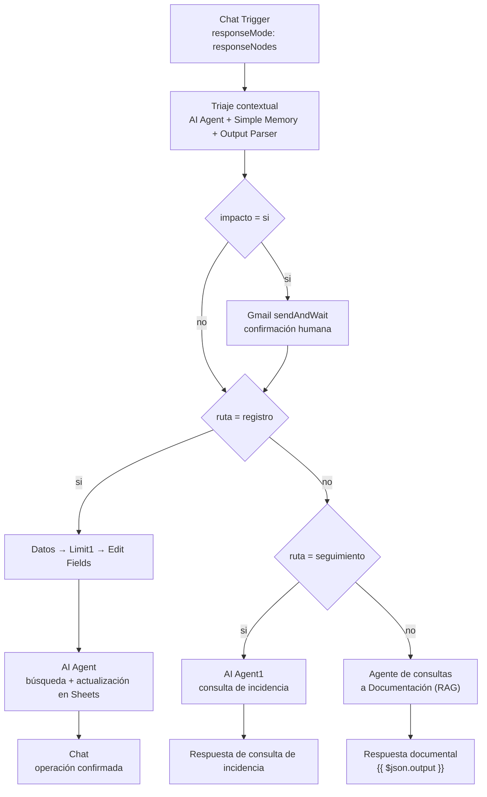

# Documentación técnica — Asistente de Negocio

| Ficha | |
|---|---|
| Orquestador | n8n 2.41.7, self-hosted sobre Docker |
| Workflow | `Asistente de negocio latest` (`workflows/Asistente de negocio latest.json`), ID `ctxag6ce4d171ba6`, versión `52dc11c9-0043-4442-9a8c-262f61a22a4b`; disponible en MCP |
| Estado | Borrador, no activo; se usa desde el editor de n8n |
| Modelo de lenguaje | `qwen3:8b` en Ollama |
| Embeddings | `nomic-embed-text:v1.5` en Ollama |
| Base vectorial | Pinecone, índice `n8n-contratos` |
| Casos de prueba | `casos-de-prueba.pdf` |

---

## 1. Resumen

El asistente recibe mensajes por chat y los clasifica en tres caminos:

1. **Registro o modificación de una incidencia**, con escritura en Google Sheets.
2. **Consulta sobre una incidencia ya registrada**, respondida con datos de la hoja.
3. **Consulta sobre normativa interna**, respondida con RAG sobre Pinecone.

El triaje es un **AI Agent** (`Triaje contextual`) con memoria propia y salida estructurada. Devuelve un JSON cerrado `{ruta, impacto}` y los `If` comparan por **igualdad exacta**:

- `ruta = registro`: alta o modificación de una incidencia.
- `ruta = seguimiento`: consulta de una incidencia ya registrada.
- `ruta = documentacion`: consulta de normativa interna.
- `impacto = si`: operación sensible o con impacto externo; activa la confirmación humana.

Cada rama tiene su propia clave de memoria (`triage:`, `doc:`, `registro:`, `seguimiento:`), de modo que el JSON del triaje no contamine el historial del agente documental.

Las respuestas usan **response nodes** (`responseMode: responseNodes`): cada rama termina en un nodo `Chat` que envía el mensaje al usuario.

---

## 2. Arquitectura



### 2.1 Triaje contextual

El nodo `Triaje contextual` es un **AI Agent v3.1** que clasifica el mensaje usando el historial de la conversación. Sus subnodos son:

- `Simple Memory - Triaje`: memoria con clave `triage:<sessionId>` y ventana de 10 mensajes.
- `Structured Output Parser (Triaje)`: fuerza un JSON con este esquema:

```json
{
  "ruta": "documentacion | registro | seguimiento",
  "impacto": "si | no"
}
```

- `Ollama Chat Model1`: `qwen3:8b` con `think:false` y `temperature:0`.

El *system prompt* pide resolver referencias como «eso», «la», «lo», «anteriores» o «el mismo» usando el historial, y elegir `documentacion` si hay duda entre documentación y registro.

Las rutas se evalúan con igualdad exacta:

| Nodo | Condición | Destino |
|---|---|---|
| `Es de impacto?` | `$json.output.impacto = "si"` | Confirmación humana por Gmail |
| `Para mirar si es un registro` | `$('Triaje contextual').first().json.output.ruta = "registro"` | Rama de incidencias |
| `If` | `$('Triaje contextual').first().json.output.ruta = "seguimiento"` | Rama de consulta de incidencia |
| `If` (falso) | `ruta = "documentacion"` | Agente documental |

### 2.2 Rama de incidencias

`Datos` lee la hoja de registro y `Limit1` conserva una sola fila. `Edit Fields` genera:

- `ID`: `INC-XXX`, incrementando el último ID de la hoja.
- `FECHA`: `$now.toFormat('yyyy-MM-dd HH:mm')`.

`AI Agent` recibe esos datos, rellena los siete campos de la incidencia y usa las herramientas `Búsqueda para modificación1` y `Actualización o creación de filas1` para buscar y escribir en Google Sheets. Su memoria usa la clave `registro:<sessionId>`.

Las tres herramientas de Sheets (`Búsqueda para modificación1`, `Actualización o creación de filas1` y `Búsqueda para consultar una incidencia registrada`) tienen asignada la credencial `Google Sheets account`. Al terminar, el nodo `Chat` responde: «Tu operación ha sido confirmada y procesada».

La validación del JSON y la escritura las realiza el agente; no hay un `Information Extractor` ni un nodo determinista de escritura.

### 2.3 Rama de consulta de incidencia

`AI Agent1` recibe el mensaje y usa la herramienta `Búsqueda para consultar una incidencia registrada`, que busca por ID en la hoja. Su memoria usa la clave `seguimiento:<sessionId>`. El agente responde con un resumen de la incidencia y el nodo `Respuesta de consulta de incidencia` envía `{{ $json.output }}` al chat.

### 2.4 Rama documental

El agente `Agente de consultas a Documentacion` es el camino por defecto para las consultas que no son registro ni seguimiento. Usa:

- Pinecone, índice `n8n-contratos`, namespace `kb-vigente-2026-10`.
- `nomic-embed-text:v1.5` para embeddings y `qwen3:8b` para redactar.
- `topK = 8` y memoria de 10 mensajes con clave `doc:<sessionId>`.
- `think:false` en los modelos del camino documental para evitar esperas largas.
- Un *system prompt* que exige buscar siempre, citar `(KB-XX, sección X)` y responder «No se ha encontrado nada de información al respecto» si no hay evidencia.

La rama termina en el nodo `Chat` **`Respuesta documental`**, que envía al usuario el campo `output` del agente (`message = {{ $json.output }}`).

La herramienta `Answer questions with a vector store` devuelve un texto redactado, no los metadatos de los fragmentos. La calidad de las citas y la latencia de esta rama se detallan en la sección de incidencias.

### 2.5 Ingesta documental

El workflow `Actualizar Drive Asistente` mantiene la base de conocimiento: detecta un PDF nuevo en Drive, lo descarga, extrae el texto, lo normaliza por secciones (`ID documental`, versión, estado y apartados numerados), lo divide con solapamiento 150 y lo indexa en Pinecone. El namespace se elige según el estado: `kb-vigente-2026-10` para `VIGENTE` y `kb-obsoletos` para el resto.

Cada fragmento conserva `document_id`, `titulo`, `version`, `seccion`, `estado` y `nombre_archivo`, y el texto se prefija con el identificador y la sección. Esto permite citar la respuesta y separar normativa vigente de obsoleta.

---

## 3. Herramientas gratuitas

| Herramienta | Uso | Coste |
|---|---|---|
| n8n 2.41.7 self-hosted | Orquestación, chat y credenciales | Fair-code; autoalojado sin coste de licencia |
| Docker | Contenedor de n8n | Gratuito para uso personal/educativo |
| Ollama | Inferencia local | MIT |
| qwen3:8b | Triaje, agentes y respuestas | Apache 2.0 |
| nomic-embed-text:v1.5 | Embeddings | Apache 2.0 |
| Pinecone | Base vectorial | Plan gratuito |
| Google Drive / Sheets / Gmail | Entrada, registro y confirmación | Cuotas gratuitas de Google |

No se usan APIs de pago de modelos: todo el procesamiento de lenguaje se hace en local.

---

## 4. Estrategia RAG (resumen)

La ingesta normaliza el PDF por secciones antes de trocearlo. Cada fragmento conserva `document_id`, `titulo`, `version`, `seccion`, `estado` y `nombre_archivo`, y el texto se prefija con el identificador y la sección.

| Parámetro | Valor |
|---|---|
| Índice | `n8n-contratos` |
| Namespace vigente | `kb-vigente-2026-10` |
| Namespace obsoleto | `kb-obsoletos` |
| `topK` | 8 |
| Fragmento / solape | 1000 / 150 caracteres |
| Memoria documental | 10 mensajes (`doc:<sessionId>`) |
| Modelo de embeddings | `nomic-embed-text:v1.5` |

---

## 5. Seguridad

- El Chat Trigger **no es público**: se usa desde el editor de n8n.
- Las credenciales de Google, Pinecone y Ollama se guardan en el almacén de n8n; los workflows solo contienen referencias.
- Las tres herramientas de Google Sheets y el nodo `Datos` tienen asignada la credencial `Google Sheets account`.
- La rama documental busca únicamente en el namespace de normativa vigente.
- La confirmación humana está **activa en el diseño** mediante Gmail `sendAndWait`. El nodo tiene credencial Gmail asignada, pero el destinatario sigue escrito directamente en el nodo y la credencial puede requerir reconexión OAuth2.
- Las memorias usan claves explícitas por rama: `triage:`, `doc:`, `registro:` y `seguimiento:`. Esto evita mezclar contexto entre conversaciones y entre ramas.
- La nueva rama de incidencias no tiene validación determinista del JSON: el agente escribe en Sheets mediante una herramienta. Conviene revisar el resultado antes de dar el flujo por válido.

---

## 6. Incidencias y dificultades

| # | Incidencia / dificultad | Causa | Estado |
|---|---|---|---|
| 1 | Seguimientos mal clasificados | El triaje no conservaba el historial y las rutas dependían de coincidencias de texto | Corregido con AI Agent + memoria + salida estructurada + igualdad exacta |
| 2 | Memorias contaminadas entre ramas | El triaje y el agente documental compartían el mismo buffer de sesión | Corregido con claves separadas `triage:`, `doc:`, `registro:` y `seguimiento:` |
| 3 | Citas documentales con UUID | La herramienta del vector store devuelve solo texto; si no incluye la cita, el agente usa el ID de la llamada a la herramienta | Pendiente: herramienta que devuelva los metadatos o pre-recuperación con Pinecone |
| 4 | Latencia del agente documental | qwen3:8b en modo *thinking* podía tardar varios minutos y el chat se quedaba cargando | Mitigado con `think:false`; pendiente medir y limitar tokens |
| 5 | Confirmación humana y validación de incidencias | Destinatario de Gmail hardcodeado y credencial pendiente de reconexión; la escritura en Sheets depende del agente | Pendiente: parametrizar Gmail y añadir validación determinista |

---

## 7. Posibles mejoras

1. **Citas documentales fiables**: sustituir `Answer questions with a vector store` por un *tool workflow* que devuelva los fragmentos con `document_id`, `seccion`, `version` y `estado`, o pre-recuperar en la rama documental y pasar el contexto formateado al agente.
2. **Parametrizar Gmail**: validar la credencial OAuth2, mover el destinatario a una variable y registrar la confirmación.
3. **Validación determinista de incidencias**: que el agente solo consulte y extraiga, y que la escritura la haga un nodo `appendOrUpdate` con un esquema validado.
4. **Fijar zona horaria e identificadores**: `Europe/Madrid` en la configuración del workflow, ID por máximo de hoja o UUID.
5. **Pruebas de regresión**: casos de registro, consulta, RAG, contraste de versiones obsoleta/vigente y contextualidad conversacional.

---

## 8. Conclusión

El asistente separa claramente el registro, la consulta de incidencias y la consulta documental. El triaje contextual aporta memoria y rutas exactas, y cada rama conserva su propio contexto. Las credenciales de Sheets están asignadas y los mensajes se controlan con `responseNodes`.

Quedan tres frentes antes de considerar el workflow listo para producción: **citas documentales fiables**, **confirmación humana parametrizada** y **validación determinista de incidencias**. La latencia del agente documental ha mejorado con `think:false`, pero conviene medirla y limitar la salida de los modelos.
