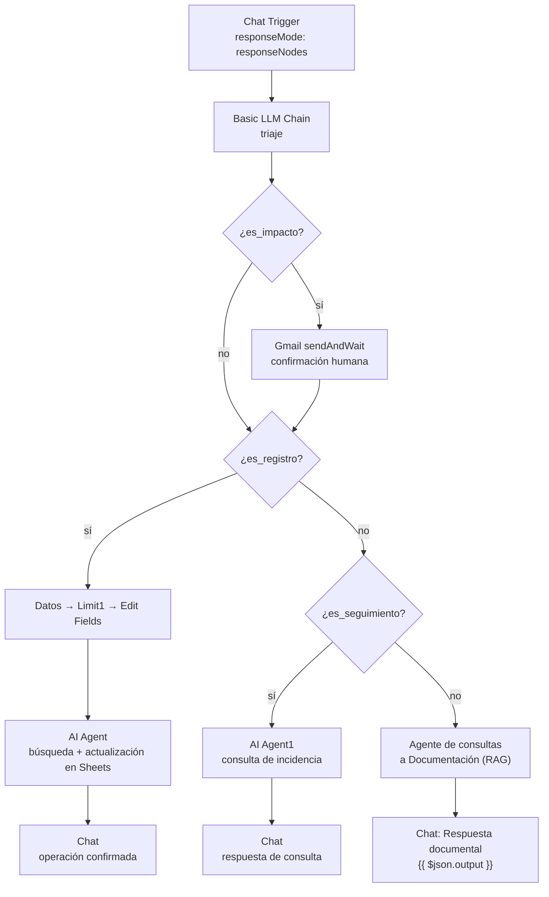

# Documentación técnica — Asistente de Negocio (versión actualizada)

| Ficha | |
|---|---|
| Fecha | 2026-11-01 |
| Orquestador | n8n 2.41.7, self-hosted sobre Docker |
| Workflow | `Asistente de negocio latest` (`workflows/Asistente de negocio.json`); disponible en MCP |
| Estado | Borrador, no activo; la versión anterior sigue activa |
| Modelo de lenguaje | `qwen3:8b` en Ollama |
| Embeddings | `nomic-embed-text:v1.5` en Ollama |
| Base vectorial | Pinecone, índice `n8n-contratos` |

---

## 1. Resumen

El asistente recibe mensajes por chat y los clasifica en tres caminos:

1. **Registro o modificación de una incidencia**, con escritura en Google Sheets.
2. **Consulta sobre una incidencia ya registrada**, respondida con datos de la hoja.
3. **Consulta sobre normativa interna**, respondida con RAG sobre Pinecone.

El cambio principal respecto a la versión anterior es el uso de **response nodes** (`responseMode: responseNodes`): el Chat Trigger ya no responde con la salida del último nodo, sino que cada rama debe terminar en un nodo `Chat` que envía el mensaje. También se añadió un agente específico para consultar incidencias y se separó el triaje en `es_registro`, `es_seguimiento` y `es_impacto`.

---

## 2. Arquitectura

### 2.1 Triaje

`Basic LLM Chain` analiza el mensaje y devuelve una o varias marcas:

- `es_registro`: alta o modificación de una incidencia.
- `es_seguimiento`: consulta sobre una incidencia ya registrada.
- `es_impacto`: operación sensible o con impacto externo; activa la confirmación humana.

El nodo `Es de impacto?` comprueba `es_impacto` y, si aparece, pasa por el nodo Gmail `sendAndWait`. Después, `Para mirar si es un registro` comprueba `es_registro`. Si no es registro, el nodo `If` comprueba `es_seguimiento`: si es seguimiento va al agente de incidencias; si no, al agente documental.

### 2.2 Rama de incidencias

`Datos` lee la hoja de registro y `Limit1` conserva una sola fila. `Edit Fields` genera:

- `ID`: `INC-XXX`, incrementando el último ID de la hoja.
- `FECHA`: `$now.toFormat('yyyy-MM-dd HH:mm')`.

`AI Agent` recibe esos datos, rellena los siete campos de la incidencia y usa las herramientas `Búsqueda para modificación1` y `Actualización o creación de filas1` para buscar y escribir en Google Sheets. El prompt insiste en ejecutarse una sola vez y en no inventar claves. Al terminar, el nodo `Chat` responde: «Tu operación ha sido confirmada y procesada».

En esta versión ya no existe el `Information Extractor` ni el nodo final de escritura: la validación del JSON y la escritura las realiza el agente mediante su herramienta.

### 2.3 Rama de consulta de incidencia

`AI Agent1` recibe el mensaje y usa la herramienta `Búsqueda para consultar una incidencia registrada`, que busca por ID en la hoja. El agente responde con un resumen de la incidencia y el nodo `Respuesta de consulta de incidencia` envía `{{ $json.output }}` al chat.

### 2.4 Rama documental

El agente `Agente de consultas a Documentacion` es el camino por defecto para las consultas que no son registro ni seguimiento. Usa:

- Pinecone, índice `n8n-contratos`, namespace `kb-vigente-2026-10`.
- `nomic-embed-text:v1.5` para embeddings y `qwen3:8b` para redactar.
- `topK = 8` y memoria de 10 mensajes con clave de sesión.
- Un *system prompt* que exige buscar siempre, citar `KB-XX, sección X` y responder «No se ha encontrado nada de información al respecto» si no hay evidencia.

La rama termina en el nodo `Chat` **`Respuesta documental`**, que envía al usuario el campo `output` del agente (`message = {{ $json.output }}`). Así se completa el requisito de `responseNodes`: cada rama tiene su propio nodo de respuesta.

### 2.5 Ingesta documental

El workflow `Actualizar Drive Asistente` sigue siendo el encargado de mantener la base de conocimiento: detecta un PDF nuevo en Drive, lo descarga, extrae el texto, lo normaliza por secciones (`ID documental`, versión, estado y apartados numerados), lo divide con solapamiento 150 y lo indexa en Pinecone. El namespace se elige según el estado: `kb-vigente-2026-10` para `VIGENTE` y `kb-obsoletos` para el resto.

---

## 3. Herramientas gratuitas

| Herramienta | Uso | Coste |
|---|---|---|
| n8n 2.41.7 self-hosted | Orquestación, chat y credenciales | Fair-code; autoalojado sin coste de licencia |
| Docker | Contenedor de n8n | Gratuito para uso personal/educativo |
| Ollama | Inferencia local | MIT |
| qwen3:8b | Triaje, agentes y respuestas | Apache 2.0 |
| nomic-embed-text:v1.5 | Embeddings | Apache 2.0 |
| Pinecone | Base vectorial | Plan gratuito |
| Google Drive / Sheets / Gmail | Entrada, registro y confirmación | Cuotas gratuitas de Google |

No se usan APIs de pago de modelos: todo el procesamiento de lenguaje se hace en local.

---

## 4. Estrategia RAG (resumen)

La ingesta normaliza el PDF por secciones antes de trocearlo. Cada fragmento conserva `document_id`, `titulo`, `version`, `seccion`, `estado` y `nombre_archivo`, y el texto se prefija con el identificador y la sección. Esto permite citar la respuesta y separar normativa vigente de obsoleta.

| Parámetro | Valor |
|---|---|
| Índice | `n8n-contratos` |
| Namespace vigente | `kb-vigente-2026-10` |
| Namespace obsoleto | `kb-obsoletos` |
| `topK` | 8 |
| Fragmento / solape | 1000 / 150 caracteres |
| Memoria documental | 10 mensajes |
| Modelo de embeddings | `nomic-embed-text:v1.5` |

---

## 5. Seguridad

- El Chat Trigger **no es público**: se usa desde el editor de n8n.
- Las credenciales de Google, Pinecone y Ollama se guardan en el almacén de n8n; los workflows solo contienen referencias.
- La rama documental busca únicamente en el namespace de normativa vigente.
- La confirmación humana está **activa en el diseño** mediante Gmail `sendAndWait`, pero la copia local del workflow no tiene credencial Gmail asignada y el destinatario está escrito directamente en el nodo.
- La nueva rama de incidencias ya no tiene validación determinista del JSON: el agente escribe en Sheets mediante una herramienta. Conviene revisar el resultado antes de dar el flujo por válido.
- `Simple Memory1` y `Simple Memory2` no definen una clave de sesión explícita; puede mezclarse contexto entre conversaciones.

---

## 6. Dificultades encontradas

| # | Dificultad | Causa | Estado |
|---|---|---|---|
| 1 | La rama documental no respondía | Con `responseNodes`, el agente documental no tenía un nodo `Chat` de salida | Resuelto: añadido `Respuesta documental` con `{{ $json.output }}` |
| 2 | La confirmación humana no está operativa en local | El nodo Gmail no tiene credencial en la copia local y el destinatario está hardcodeado | Pendiente: asignar credencial y parametrizar el correo |
| 3 | Se perdió la validación determinista de la incidencia | Se eliminaron `Information Extractor` y el nodo final de escritura; el agente escribe por herramienta | Pendiente: validar el JSON o volver a una escritura determinista |
| 4 | Fecha e ID dependen de la configuración y del orden de la hoja | La copia local no fija `timezone`; el ID se calcula desde la última fila | Pendiente: fijar `Europe/Madrid` y calcular el máximo ID o usar UUID |

La corrección de expresiones con `.first()` en subnodos y el `Limit` para evitar prompts triples se mantiene en esta versión.

---

## 7. Mejoras propuestas

1. **Configurar y parametrizar Gmail**: asignar la credencial OAuth2, mover el destinatario a una variable y añadir un registro de auditoría de la confirmación.
2. **Recuperar una validación determinista**: que el agente solo consulte y extraiga, y que la escritura la haga un nodo `appendOrUpdate` con un esquema validado; así se evitan duplicados y campos vacíos.
3. **Fijar la zona horaria y robustecer los identificadores**: `Europe/Madrid` en la configuración del workflow, ID por máximo de hoja o UUID, y claves de sesión explícitas en las memorias.

---

## 8. Conclusión

La nueva versión mejora el triaje y separa claramente el registro, la consulta de incidencias y la consulta documental. El uso de `responseNodes` da control explícito sobre los mensajes y las tres ramas ya tienen su nodo `Chat`: `Chat`, `Respuesta de consulta de incidencia` y `Respuesta documental`. Antes de activar el workflow conviene configurar Gmail y decidir si se mantiene la escritura directa del agente o se recupera la validación determinista.
